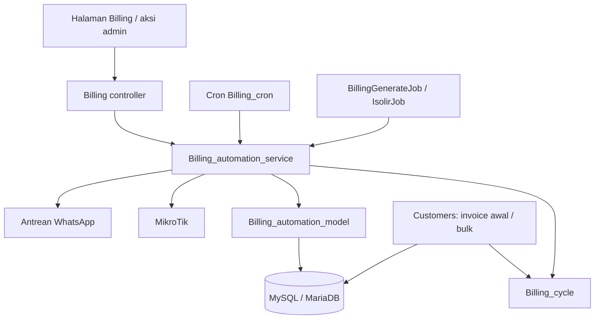

# Dokumentasi lengkap billing dan operasional RTRWNet

Tanggal penyusunan: **22 Oktober 2026 (WIB)**. Basis: pembacaan source di repository ini, konfigurasi contoh, dependency lock, route, migrasi, dan skrip deployment. Dokumentasi ini menggambarkan implementasi yang tersedia di source; status pemasangan di server, jumlah pelanggan, saldo produksi, performa, serta keberhasilan integrasi langsung belum diaudit.

## 1. Peta dokumentasi

| Dokumen | Isi dan pembaca |
| --- | --- |
| Dokumen ini | Gambaran produk, spesifikasi fitur, aturan billing, alur kerja, role, dan batas implementasi; untuk owner, admin, dan pengembang |
| [Spesifikasi teknis dan data](14_SPESIFIKASI_TEKNIS_DAN_DATA.md) | Arsitektur, stack, relasi data, kamus field inti, integrasi, konfigurasi, dan kontrol akses |
| [Operasional, deployment, dan pengujian](15_OPERASIONAL_DEPLOYMENT_DAN_PENGUJIAN.md) | Kebutuhan server, instalasi, cron, worker, backup, troubleshooting, dan skenario verifikasi |
| [Referensi endpoint dan source](16_REFERENSI_ENDPOINT_DAN_SOURCE.md) | Inventaris seluruh alias route eksplisit, controller/public method, migrasi, dependency, dan nama environment |
| [Inventaris JSON](INVENTARIS_SOURCE_RTRWNET.json) | Data inventaris yang bisa diolah lagi menjadi spreadsheet atau tooling dokumentasi |

Dokumen `01` dan `07` serta runbook lama tetap berguna sebagai referensi historis. Bila penjelasannya berbeda, gunakan source dan paket dokumentasi `13`–`16` sebagai baseline pembacaan terbaru. Detail perubahan tagihan dua bulan ada di [panduan siklus dan penagihan rumah](BILLING_CYCLES_OFFLINE_COLLECTION.md).

## 2. Identitas dan ruang lingkup produk

RTRWNet adalah aplikasi web untuk operasional ISP/RTRWNet: menghubungkan data pelanggan, paket internet, tagihan, pembayaran, keuangan, pekerjaan teknisi, gangguan, router, dan ONT. Nama/asset lama seperti Nawacore dan Bujanaya masih muncul di sebagian source; branding dapat diatur melalui konfigurasi aplikasi dan branding router.

| Aspek | Spesifikasi implementasi |
| --- | --- |
| Model instalasi utama | Single install; satu aplikasi dengan beberapa router/distribusi |
| Pemisahan operasional | `router_id`, router aktif pada session, serta hak akses router per user |
| Pengguna utama | `superadmin`, `admin`, `teknisi` |
| Jenis layanan pelanggan | PPPoE dan Static IP |
| Kanal aplikasi | Web server-rendered, PWA, wrapper Android Capacitor |
| Mata uang pada tampilan billing | Rupiah; perhitungan nominal disimpan/diproses dengan pembulatan dua desimal pada service billing |
| Zona waktu aplikasi | `Asia/Jakarta` dari entrypoint; laporan penagihan rumah juga menetapkannya secara eksplisit |
| Penyimpanan | MySQL/MariaDB; file upload; cache/log; Redis opsional untuk antrean |
| Integrasi | MikroTik RouterOS API, Telegram, GenieACS/FreeACS, WhatsApp gateway, Pusher |
| Komponen kompatibilitas | File tenant/subscription/SaaS masih ada; bukan bukti produk SaaS penuh aktif |

## 3. Ringkasan spesifikasi fitur

Istilah **tersedia di source** berarti controller/service/view terkait ditemukan. Integrasi tetap membutuhkan schema, konfigurasi, koneksi, dan pengujian pada lingkungan tujuan.

| Modul | Fitur yang tersedia di source | Sumber utama |
| --- | --- | --- |
| Autentikasi | Login/logout, captcha hitungan, pembatasan percobaan login, session idle timeout, user aktif | [Auth](../application/controllers/Auth.php) |
| User dan distribusi | CRUD user, role, akses ke satu/beberapa router, router aktif | [Users](../application/controllers/Users.php), [MY_Controller](../application/core/MY_Controller.php) |
| Dashboard | KPI pelanggan, invoice, keuangan, instalasi, tiket, PPP aktif; router switcher | [Dashboard](../application/controllers/Dashboard.php) |
| Pelanggan | CRUD, pencarian/pagination, PPPoE/static, kredensial otomatis, lokasi/OLT, bulk action, preferensi billing | [Customers](../application/controllers/Customers.php), [Customer_model](../application/models/Customer_model.php) |
| Paket layanan | CRUD PPP profile, harga, sinkronisasi profile MikroTik | [Ppp_profiles](../application/controllers/Ppp_profiles.php) |
| IP pool | CRUD, sinkronisasi, refresh pemakaian dan kapasitas | [Ip_pools](../application/controllers/Ip_pools.php) |
| Upgrade paket | Preview prorata, perubahan paket/profile dan assignment jaringan, histori, invoice tambahan bila nominal positif | [CustomerUpgrade](../application/controllers/CustomerUpgrade.php) |
| Billing | Generate periodik/rolling/manual, detail/edit, pembayaran sebagian/lunas, overdue, void/hapus sesuai role, bulk action | [Billing](../application/controllers/Billing.php), [service billing](../application/libraries/Billing_automation_service.php) |
| Siklus tagihan | Interval 1 atau 2 bulan, bulan awal siklus, penolakan periode bertumpang tindih | [Billing_cycle](../application/libraries/Billing_cycle.php) |
| Penagihan rumah | Preferensi `cash_visit`, rekap tunggakan dan periode berjalan, Telegram per router, snapshot dan retry per bagian | [Offline_collection_service](../application/libraries/Offline_collection_service.php) |
| WhatsApp | Deeplink invoice; antrean gateway; notifikasi invoice/lunas; reminder; log dan resend | [Whatsapp_service](../application/libraries/Whatsapp_service.php), [Cron_whatsapp](../application/controllers/Cron_whatsapp.php) |
| Cashflow | Income/expense, kategori, ringkasan/chart, request perubahan admin dan review superadmin | [Cashflow_ui](../application/controllers/Cashflow_ui.php) |
| Router | CRUD, tes koneksi, status aktif, logo/branding, konfigurasi API | [Routers](../application/controllers/Routers.php) |
| PPPoE sync | Sinkronisasi secret, pencocokan/migrasi pelanggan, setting sync | [Settings](../application/controllers/Settings.php), [Settings_model](../application/models/Settings_model.php) |
| Static IP sync | Sinkronisasi ARP/queue/pelanggan, pengecekan isolir static | [Static_ip_sync](../application/controllers/Static_ip_sync.php) |
| Isolir manual | Cari target, isolir dan release PPPoE/static sesuai konteks jaringan | [Manual_isolir](../application/controllers/Manual_isolir.php) |
| Hotspot | Daftar data router, tambah user, generate banyak user, tambah profile | [Hotspot](../application/controllers/Hotspot.php) |
| Work order | Pembuatan, jenis pekerjaan, penugasan teknisi, penyelesaian, penghapusan, notifikasi Telegram | [Workorders](../application/controllers/Workorders.php) |
| Helpdesk | Tiket, filter, penugasan/status, reply, lampiran, informasi PPP, SLA, laporan | [Helpdesk](../application/controllers/Helpdesk.php), [Ticket_model](../application/models/Ticket_model.php) |
| Kinerja teknisi | KPI, target, ranking/poin, daftar WO/tiket, export PDF | [Teknisi_dashboard](../application/controllers/Teknisi_dashboard.php) |
| Monitoring | Snapshot router, CPU/memori/disk/traffic/PPP, health check, konfigurasi interface, alert | [Monitoring](../application/controllers/Monitoring.php) |
| ONT monitoring | Sinkronisasi GenieACS, online/offline, detail, reboot, perubahan WiFi | [Ont](../application/controllers/Ont.php) |
| ONT remote/API | Aksi ONT per pelanggan, connected devices, ringkasan, token/basic API | [Ont_remote](../application/controllers/Ont_remote.php), [API Ont](../application/controllers/api/Ont.php) |
| Peta fiber | Topologi router–OLT–ODC–ODP–pelanggan, node management, marker cluster | [NetworkMap](../application/controllers/NetworkMap.php) |
| Master referensi | Lokasi dan OLT, CRUD/bulk update/delete sesuai akses | [Master_references](../application/controllers/Master_references.php) |
| Notifikasi/audit | Notifikasi tersimpan dan Pusher, baca/belum dibaca, log aktivitas user, pencatatan cron | [Notification](../application/controllers/Notification.php), [User_logs](../application/controllers/User_logs.php) |
| Provisioning alternatif | Endpoint onboarding pending, secret PPP, penugasan teknisi dan callback Telegram | [Provisioning](../application/controllers/Provisioning.php), [Telegram_webhook](../application/controllers/Telegram_webhook.php) |

## 4. Role dan akses router

Login utama hanya menerima role hasil normalisasi `superadmin`, `admin`, dan `teknisi`. Alias legacy seperti `owner` menjadi `superadmin`, `tenant_admin` menjadi `admin`, dan `technician` menjadi `teknisi`. Indikator demo di sebagian UI tidak berarti `demo` merupakan role login yang didukung alur utama.

| Area | Superadmin | Admin | Teknisi |
| --- | --- | --- | --- |
| Dashboard | Ringkasan operasional | Ringkasan sesuai scope | Dialihkan ke dashboard teknisi |
| Pelanggan/billing/upgrade/cashflow | Akses | Akses sesuai scope | Tidak melalui modul utama |
| WO | Lihat/buat/kelola | Lihat/buat sesuai scope | Akses pekerjaan sesuai aturan controller |
| Helpdesk | Kelola; hapus tiket melalui guard superadmin | Kelola sesuai scope | Akses tiket sesuai penugasan/aturan model |
| ONT monitoring | Akses | Akses | Akses internal; beberapa aksi dibatasi lagi |
| ONT remote, hotspot, map, router/ACS | Akses | Akses sesuai guard/scope modul | Tidak melalui controller utama terkait |
| Settings sistem | Akses | Terbatas pada halaman Telegram, kelola grup, dan tes dispatch yang diizinkan | Tidak |
| User management | Kelola termasuk superadmin | Kelola target yang diizinkan; tidak mengelola superadmin | Tidak |
| Review perubahan cashflow | Approve/reject | Membuat request perubahan tertentu | Tidak |
| Scope router | Semua router atau satu router aktif | Satu router aktif dari daftar router yang diberikan | Satu router aktif dari daftar router yang diberikan |

Matrix global di [rbac_helper](../application/helpers/rbac_helper.php) mencakup customers, billing, work_orders, tickets, settings. Modul lain menambahkan guard masing-masing; tabel di atas merupakan ringkasan dan bukan pengganti pemeriksaan setiap aksi.

`user_router_access` menyimpan relasi banyak router untuk satu user. `users.router_scope_id` dipertahankan sebagai kompatibilitas. `MY_Controller` memuat daftar yang diizinkan lalu memilih satu router aktif ke session. Admin/teknisi tidak memperoleh tampilan gabungan semua router hanya karena diberi beberapa router. Filter bersama menolak akses data ketika non-superadmin tidak memiliki scope; setiap modul tetap perlu memakai filter tersebut dengan benar.

## 5. Spesifikasi pelanggan dan provisioning

### 5.1 Data pelanggan

Form menangani identitas/kode pelanggan, nama, nomor HP, alamat, data lokasi/jaringan, router, paket/profile, tanggal pemasangan, status, dan preferensi billing. Kolom yang benar-benar ditulis disesuaikan dengan field yang tersedia di schema. Detail field inti ada pada kamus data teknis.

Preferensi billing terbaru:

| Field | Nilai/perilaku |
| --- | --- |
| `due_date_day` | Hari jatuh tempo 1–31; penyesuaian bulan pendek dilakukan saat menghitung due date |
| `billing_interval_months` | `1` atau `2`; harga paket tetap harga per bulan |
| `billing_cycle_start` | Awal bulan anchor untuk siklus dua bulan, tersimpan sebagai `YYYY-MM-01` |
| `payment_collection_method` | `unspecified`, `transfer`, `cash_visit` |

**Cara penagihan** adalah preferensi operasional pelanggan. **Metode pembayaran** adalah cara transaksi tertentu dibayar. Pembayaran cash tidak otomatis mengubah preferensi pelanggan menjadi kunjungan rumah.

### 5.2 Alur tambah pelanggan PPPoE

1. Admin memilih router aktif, paket, data pelanggan, preferensi billing, dan teknisi bila diperlukan.
2. Sistem memvalidasi data serta membentuk username/password dan assignment jaringan.
3. Dalam transaksi database, sistem menyimpan pelanggan, mengupsert layanan, dan membuat invoice awal jika berada pada bulan siklus.
4. Sistem mencoba provisioning secret ke MikroTik pada router terkait. Kegagalan menggagalkan transaksi database pada jalur ini.
5. Setelah commit, sistem mencoba membuat WO pemasangan dan menjalankan notifikasi terkait.

Transaksi database tidak membuat aksi MikroTik menjadi atomik. Bila router sudah berubah tetapi proses database gagal sesudahnya, operator perlu merekonsiliasi keduanya. WO yang gagal setelah commit juga tidak berarti pelanggan otomatis batal dibuat.

### 5.3 Alur pelanggan Static IP

Cabang static menyimpan pelanggan tanpa provisioning PPPoE. Paket/harga dapat dipilih; invoice awal dibuat ketika harga paket positif dan periodenya memenuhi siklus. Pengelolaan queue/ARP/isolir menggunakan modul static. Jangan mengasumsikan semua efek WO pada cabang PPPoE juga terjadi pada cabang static.

### 5.4 Kelola pelanggan

Tersedia pencarian/pagination, edit, delete sesuai perilaku model/controller, bulk delete, bulk disable, dan bulk generate invoice. Source terbaru juga menyediakan bulk ubah cara penagihan menjadi **Transfer** atau **Cash — Kunjungan rumah**, melalui `customers/bulk_update_collection_method`. Aksi ini hanya untuk admin/superadmin, memakai POST dan ID pelanggan terpilih, serta memfilter pelanggan yang dapat diakses melalui model.

[Customer_model](../application/models/Customer_model.php) menangani pembacaan/penulisan data, field filtering, soft-delete compatibility, pemeriksaan username, dan scope router. Aturan nominal dan periode billing berada terutama di service/model billing dan helper invoice pada controller pelanggan.

## 6. Aturan billing yang berlaku pada jalur utama

### 6.1 Komponen dan jalur pemanggilan



Jalur utama memakai field `billing_period_start`, `billing_period_end`, `total_amount`, `paid_amount`, `balance_amount` dan status `issued`. Engine lain bernama `Billing_engine` memakai kontrak `period_month`/`amount`/`unpaid` dan dependensi yang tidak lengkap; baca bagian batas implementasi sebelum memakai cron lama.

### 6.2 Pelanggan yang ditagih otomatis

Generator utama mencari status pelanggan `active`, `suspended`, `isolated`, dan `isolir`. Pelanggan terminated tidak termasuk daftar tersebut. Dengan demikian, pelanggan yang sedang diisolir tetap dapat menerima invoice periode berikutnya pada jalur ini. Data paket/harga dan router diambil dari customer/service/profile dengan fallback sesuai schema.

### 6.3 Mode generate

| Mode | Pemicu/perilaku |
| --- | --- |
| Per periode | `generate_monthly_invoices('YYYY-MM', router_id)`; membuat invoice untuk periode yang diminta tanpa menunggu tanggal jatuh tempo |
| Rolling harian | `generate_daily_rolling_invoices(date, router_id)`; hanya membuat invoice bila run date sama dengan due date pada bulan/siklus tersebut |
| Service tanpa periode | `generate_monthly_invoices(null, ...)` beralih ke rolling harian |
| Cron `Billing_cron generate_invoice` tanpa query | Controller mengisi periode bulan berjalan dan default mode `monthly`; hasilnya mode per periode |
| Invoice awal | Dibentuk saat tambah customer melalui helper di `Customers`; mematuhi siklus dan tarif dikali jumlah bulan |
| Bulk dari customer | Helper invoice pada `Customers`, dengan pemeriksaan overlap siklus |

Perbedaan default service dan default controller cron ini berpengaruh pada kapan invoice muncul. Untuk laporan kunjungan rumah tanggal 10, invoice periode berjalan harus sudah diterbitkan sebelum laporan dibentuk. Rolling untuk pelanggan yang jatuh tempo tanggal 20 belum menerbitkan invoice bulan itu pada tanggal 10.

### 6.4 Periode dan nominal

```text
subtotal       = harga bulanan × jumlah bulan dalam siklus
total_amount   = subtotal + tax_amount − discount_amount
balance_amount = total_amount − paid_amount
```

Generator reguler saat ini mengisi pajak dan diskon `0`. Field tersebut tersedia dan dapat terlibat pada perubahan invoice, tetapi itu belum merupakan engine pajak atau diskon otomatis.

| Contoh ilustratif | Hasil |
| --- | --- |
| Paket Rp150.000, interval 1, periode Nov 2026 | 1–30 Nov; subtotal Rp150.000 |
| Paket Rp150.000, interval 2, anchor Nov 2026 | 1 Nov–31 Des; subtotal Rp300.000 |
| Siklus yang sama, generate Des 2026 | Dilewati karena Des bukan bulan awal siklus |
| Siklus yang sama, generate Jan 2027 | 1 Jan–28 Feb; subtotal Rp300.000 |
| Due day 31 pada Feb 2027 | Due date menyesuaikan ke 28 Feb |

Jatuh tempo berada di bulan pertama siklus; tagihan dua bulan tidak otomatis memindahkan jatuh tempo ke bulan kedua. Penentu due day pada service utama mendahulukan `due_date_day`, lalu `billing_date` bila valid, lalu hari pemasangan; fallback terakhir hari `1` bila tanggal pemasangan tidak valid. Data legacy dapat memanfaatkan tanggal instalasi/field lain; kode juga memiliki fallback pembacaan tanggal dari password lama. Data tanggal eksplisit sebaiknya menjadi referensi operasional.

Migrasi [customer_due_date_day](../application/migrations/20260607120000_customer_due_date_day.php) secara khusus mengisi due day `20` untuk router bernama Kalisari. Ini perilaku khusus instalasi pada migrasi, bukan aturan universal seluruh router.

### 6.5 Pencegahan duplikasi dan perubahan siklus

Generator memeriksa apakah rentang periode baru beririsan dengan invoice pelanggan berstatus selain `void`. Invoice yang sudah lunas tetap menghalangi penagihan ulang periode yang sama. Error insert duplicate key juga diperhitungkan sebagai skipped pada generator service.

Mengubah interval pelanggan tidak menulis ulang invoice lama. Pilih bulan awal siklus yang belum tercakup invoice. Pemeriksaan overlap di aplikasi tidak sendirinya menjamin keamanan terhadap semua proses generate yang berjalan bersamaan; indeks/constraint aktual database tetap perlu diperiksa.

### 6.6 Status dan tindakan invoice

| Status | Arti pada alur utama |
| --- | --- |
| `issued` | Invoice diterbitkan, memiliki sisa tagihan |
| `partially_paid` | Sebagian nominal telah dibayar |
| `overdue` | Ditandai lewat jatuh tempo/aturan overdue atau aksi manual |
| `paid` | Sisa tagihan nol setelah pembayaran |
| `void` | Invoice dibatalkan pada jalur soft delete admin |
| `draft` dan status legacy | Dapat dijumpai pada schema/filter kompatibilitas; bukan keluaran default generator utama |

Status pelanggan, invoice, dan sesi PPP adalah tiga hal berbeda. Pelanggan `active` belum membuktikan sesi PPP online; invoice `paid` juga belum membuktikan semua tunggakan pelanggan selesai.

### 6.7 Pencatatan pembayaran

1. Sistem mengambil invoice dan memvalidasi ID, nominal positif, metode, serta sisa tagihan. Nominal melebihi sisa ditolak.
2. Sistem menyimpan `payments` dengan status confirmed pada schema yang mendukungnya.
3. `paid_amount` bertambah; saldo dihitung ulang. Sisa positif menghasilkan `partially_paid`, sisa nol menghasilkan `paid`.
4. Saat lunas, sistem memeriksa invoice lain yang masih menghalangi pembukaan isolir.
5. Pada jalur service utama, income cashflow dibuat sekali untuk **total invoice ketika lunas**. Pembayaran sebagian belum menghasilkan income cashflow melalui cabang ini.
6. Setelah commit, sistem mencoba pelepasan entry isolir dan enqueue WhatsApp konfirmasi lunas; hasilnya perlu diperiksa terpisah dari keberhasilan transaksi pembayaran.

Tombol **Lunas** menerima `cash` dan `bank_transfer`; nominalnya diambil dari sisa invoice. Endpoint `record_payment` mendukung pencatatan nominal pembayaran. Pembayaran sebagian perlu diakses melalui alur/endpoint yang sesuai; keberadaan servicenya tidak menjamin setiap tampilan memiliki form cicilan.

Contoh: invoice Rp300.000 dibayar Rp100.000 lalu Rp200.000. Setelah transaksi pertama saldo Rp200.000 dan status partially paid. Setelah transaksi kedua saldo nol dan cashflow otomatis pada jalur ini bernilai Rp300.000. Ini perlu dipahami ketika merekonsiliasi laporan penerimaan kas per tanggal pembayaran.

### 6.8 Overdue, suspend, dan release

Auto suspend service memiliki default grace `5` hari. Target meliputi pelanggan aktif dengan saldo invoice `issued`/`partially_paid` yang due date-nya mencapai cutoff, atau invoice `overdue` dengan saldo. Sistem menandai invoice, mengubah pelanggan menjadi suspended, dan melakukan aksi jaringan sesuai konteks. Aksi manual dapat menghasilkan status overdue lebih cepat dari perhitungan grace.

Pada pelunasan:

- Bila masih ada invoice penghalang isolir, pelanggan tidak otomatis dibuka hanya karena satu invoice lunas.
- `BILLING_APPLY_MIKROTIK_ON_MARK_PAID=1` mengaktifkan cabang pemulihan profile PPPoE di dalam transaksi; default contoh env adalah `0`.
- **Terlepas dari flag tersebut, source tetap memanggil percobaan pembersihan entry isolir setelah commit saat invoice lunas**, selama pemeriksaan tunggakan mengizinkan dan router ditemukan.
- Static memiliki jalur rekonsiliasi melalui `check_static_isolir`; pemulihan profile PPPoE bukan mekanisme aktivasi static.

Karena itu, flag `0` tidak dapat diartikan sebagai jaminan pelunasan sama sekali tidak menyentuh MikroTik. Kegagalan release setelah commit tidak membatalkan pembayaran yang sudah tersimpan; periksa hasil `isolir_release` dan log.

### 6.9 Edit dan hapus invoice

Tersedia perubahan data/status invoice dan penyesuaian state pembayaran pada jalur edit. Koreksi invoice yang telah menerima pembayaran dapat memengaruhi payment/cashflow terkait; tinjau controller dan rekonsiliasi sebelum koreksi operasional.

Admin menghapus invoice melalui perubahan ke `void` dengan catatan. Superadmin memiliki **hard delete** yang menghapus payment dan cashflow terkait sebelum invoice. Maka pernyataan historis “invoice tidak pernah dihapus” tidak berlaku untuk seluruh aplikasi saat ini.

## 7. Penagihan rumah dan WhatsApp

### 7.1 Rekap kunjungan rumah

Pelanggan dipilih berdasarkan `payment_collection_method = cash_visit`, status layanan yang ditagih, scope router, dan invoice `issued`/`overdue`/`partially_paid` dengan saldo positif. Periode invoice harus sudah dimulai pada tanggal laporan; due date tidak harus sudah lewat.

Cron mengirim hanya pada tanggal **10 mulai 08.00 WIB**. Isi laporan meliputi nama, HP, alamat, periode, dan total sisa seluruh invoice yang memenuhi filter. Pelanggan transfer/belum ditentukan, terminated/terhapus, invoice lunas/void/draft, dan periode masa depan dikecualikan.

Tujuan hanya grup Telegram bertipe `collection` aktif pada router yang sama dan bot aktif. Tidak ada fallback ke grup admin/owner/router lain. Pesan panjang dipecah; snapshot dan status tiap bagian disimpan per bulan/router/grup. Retry melewati bagian yang sudah terkirim. Pengiriman HTTP tidak menjamin exactly-once bila proses terhenti setelah Telegram menerima pesan tetapi sebelum status tersimpan. Snapshot lama juga tidak otomatis berubah mengikuti pembayaran atau perpindahan Chat ID setelah snapshot dibuat.

### 7.2 WhatsApp

Terdapat dua mekanisme: tombol deeplink pada invoice, serta pengiriman server ke gateway melalui antrean `wa_message_logs`.

Gateway mencakup invoice baru dari service billing, konfirmasi lunas, reminder H-3/H-1/hari H, reminder overdue, jeda pengiriman, batas batch/retry, daftar log, detail respons, dan resend. Keberadaan hook di service tidak berarti semua jalur invoice lain (misalnya helper onboarding) otomatis memiliki perilaku enqueue yang sama.

Gateway harus dikonfigurasi eksplisit dan cron WhatsApp harus dipasang. Template installer standar belum memuat cron WhatsApp. Panduan lengkap tersedia di [WhatsApp gateway](WHATSAPP_GATEWAY_USAGE.md).

## 8. Keuangan dan upgrade paket

Cashflow menyediakan income/expense manual, kategori, filter periode/jenis/pencarian, chart, ringkasan income–expense–net, dan bulk action. Admin membuat request untuk perubahan/penghapusan tertentu; superadmin mereview approve/reject. Implementasi menyesuaikan nama tabel/kolom request yang tersedia, sehingga schema approval harus diverifikasi pada instalasi tujuan.

Dashboard dan analytics menyediakan ringkasan pendapatan, tren, ARPU, serta kelompok paket. Angka pendapatan invoice, pembayaran, dan cashflow harus dibaca berdasarkan sumber query modulnya; jangan mengasumsikan semua chart memakai basis pengakuan kas yang sama.

Upgrade paket mengubah paket/profile pelanggan, data layanan, assignment jaringan, dan histori. Opsi prorata memakai rumus source berikut:

```text
selisih_harga = harga_baru − harga_lama
sisa_hari    = max(0, 30 − tanggal_dalam_bulan)
prorata      = round((selisih_harga / 30) × sisa_hari, 2)
```

Rumus memakai basis 30 hari. Invoice prorata dibuat bila hasil positif; jangan menganggap ada refund otomatis untuk hasil nol/negatif atau perhitungan khusus sisa siklus dua bulan. Alur upgrade dan tagihan dua bulan perlu diuji bersama sebelum dijadikan kebijakan komersial.

## 9. Operasional teknisi dan gangguan

WO mendukung jenis installation, maintenance, relocation, termination, dan other; penugasan teknisi, penomoran, penyelesaian, dan Telegram. Selain controller daftar utama `Workorders`, ada controller aksi `Work_order`; keduanya perlu dibedakan saat menelusuri aktivasi/pembatalan pekerjaan.

Helpdesk memakai status `OPEN`, `ASSIGNED`, `PROGRESS`, `RESOLVED`, `CLOSED`; prioritas LOW/MEDIUM/HIGH/URGENT. Default deadline SLA dihitung dari waktu pembuatan: 24/12/6/2 jam. Ini deadline dalam jam kalender, bukan kalender jam kerja. Tersedia reply (`ticket_replies`), attachment, informasi PPP pelanggan, dashboard, laporan PDF, dan export Excel pada dashboard terkait. Teknisi dibatasi oleh aturan penugasan/model selain scope router.

Dashboard teknisi menyediakan target instalasi/tiket, KPI, daftar kerja, ranking/poin, dan PDF. Nilai target atau poin yang muncul perlu dibaca dari aturan/model aktif; dokumentasi ini tidak menetapkan target bisnis baru.

## 10. Jaringan, ONT, monitoring, dan akses mobile

Router menyediakan konfigurasi API dan tes koneksi. Profile/pool dapat disinkronkan; static sync menangani ARP/queue dan rekonsiliasi pelanggan. Hotspot mendukung user/profile dan generate user dari router; keberadaannya belum membuktikan sistem penjualan voucher lengkap dengan stok/komisi/akuntansi voucher.

ONT monitoring menyimpan cache perangkat GenieACS per router; detail, status, reboot, dan set WiFi bergantung parameter yang tersedia di perangkat. ONT remote menghubungkan aksi ke customer dan mendukung connected devices. FreeACS SOAP/REST bridge merupakan jalur integrasi tambahan. Ini bukan bukti provisioning CLI OLT multivendor tersedia; master OLT dan peta fiber berfungsi sebagai data/topologi pada source yang ditinjau.

Monitoring menampilkan resource, traffic/interface, PPP, beberapa KPI bisnis, snapshot dan alert jaringan. Default konfigurasi refresh 10 detik, cache snapshot 45 detik, CPU alert 80%, cooldown alert 300 detik. Konfigurasi interface per router dapat mengubah sumber data. Tampilan refresh bukan jaminan data router diperbarui pada setiap refresh karena cache.

Peta fiber memvisualisasikan router–OLT–ODC–ODP–pelanggan, lokasi dan kapasitas, node management, serta marker cluster. PWA memberi instalasi dan fallback/cache browser; transaksi offline dengan sinkronisasi pembayaran kemudian tidak ditemukan sebagai alur lengkap. Android adalah wrapper yang membuka URL web server, sehingga tetap bergantung koneksi server untuk operasi utama. Konfigurasi URL pada wrapper yang tersimpan masih berupa contoh.

## 11. Batas implementasi dan hal yang harus diverifikasi

| Temuan berbasis source | Dampak pada pemakaian |
| --- | --- |
| `Billing_engine` memuat `payment_model`, `package_model`, helper `billing`, dan `Code_generator` yang kosong/tidak tersedia lengkap | Cron `Invoice_cron` yang memuat engine tersebut belum layak dianggap berjalan tanpa perbaikan/verifikasi |
| Template cron installer masih memanggil `Invoice_cron generate/check_overdue` | Ikuti pembahasan jalur billing utama dalam runbook; jangan menyalin jadwal lama sebagai bukti sistem sudah otomatis |
| Beberapa halaman memiliki fallback sample rows ketika schema tidak tersedia | Halaman yang berhasil tampil belum membuktikan data operasional/schema valid |
| Data dasar pelanggan/invoice bukan seluruhnya dibuat migrasi yang ada | Fresh install memerlukan schema dasar terpisah yang sesuai; inventaris field bukan dump database siap restore |
| `composer.json` masih menyatakan PHP `>=5.3.7`, sementara kode/dependency memakai fitur lebih baru | Gunakan target PHP installer dan verifikasi dependency; constraint root itu bukan minimum operasional yang akurat |
| Template `.env.example` belum mencakup seluruh `WA_*`; default queue di file config dan env contoh berbeda | Tetapkan driver dan konfigurasi gateway eksplisit |
| Hard delete invoice tersedia untuk superadmin | Kebijakan arsip harus memperhitungkan penghapusan payment/cashflow terkait |
| Cashflow otomatis service dibuat pada pelunasan penuh | Rekonsiliasi cicilan terhadap laporan penerimaan kas perlu perhatian |
| Transaksi database dan aksi MikroTik/HTTP tidak atomik | Perlu prosedur rekonsiliasi bila salah satu berhasil dan lainnya gagal |
| PWA menyimpan respons navigasi di cache browser | Kebijakan penggunaan perangkat bersama dan data tersimpan perlu ditinjau; offline bukan sekadar halaman kosong |
| File tenant/subscription tetap berada di repository | Jangan mengklaim multi-tenant/SaaS aktif hanya dari nama file |

Portal pelanggan mandiri, payment gateway dengan callback settlement, rekonsiliasi bank otomatis, perpajakan otomatis, RADIUS, high availability, dan jaminan kapasitas/SLA belum terverifikasi sebagai alur lengkap dari peninjauan ini. Ketiadaan verifikasi bukan pernyataan bahwa semua bentuk implementasinya mustahil ada; jangan memasukkannya ke spesifikasi komersial sebagai fitur terjamin tanpa bukti tambahan.

## 12. Istilah

| Istilah | Makna dalam dokumentasi |
| --- | --- |
| Router/distribusi | Unit pemisahan operasional yang diwakili record router dan `router_id` |
| Router aktif | Satu router yang dipilih pada session user untuk konteks operasi |
| Periode billing | Rentang kalender yang dicakup satu invoice |
| Due day/due date | Hari jatuh tempo pilihan pelanggan / tanggal konkret invoice |
| Anchor siklus | Bulan pertama untuk menghitung urutan siklus dua bulan |
| Outstanding/balance | Sisa nominal invoice yang belum dibayar |
| Isolir | Pembatasan layanan melalui mekanisme jaringan yang dipakai instalasi |
| ACS/NBI | Sistem pengelolaan CPE/ONT dan antarmuka backend yang dipanggil aplikasi |
| WO | Work order atau perintah kerja teknisi |
| SLA | Batas waktu penanganan tiket menurut prioritas |
