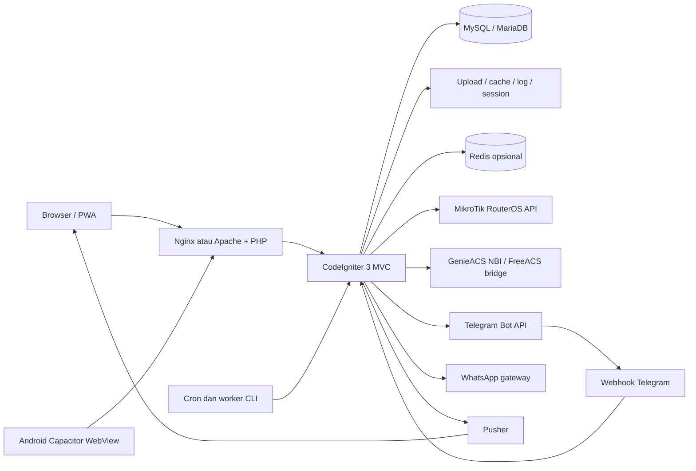
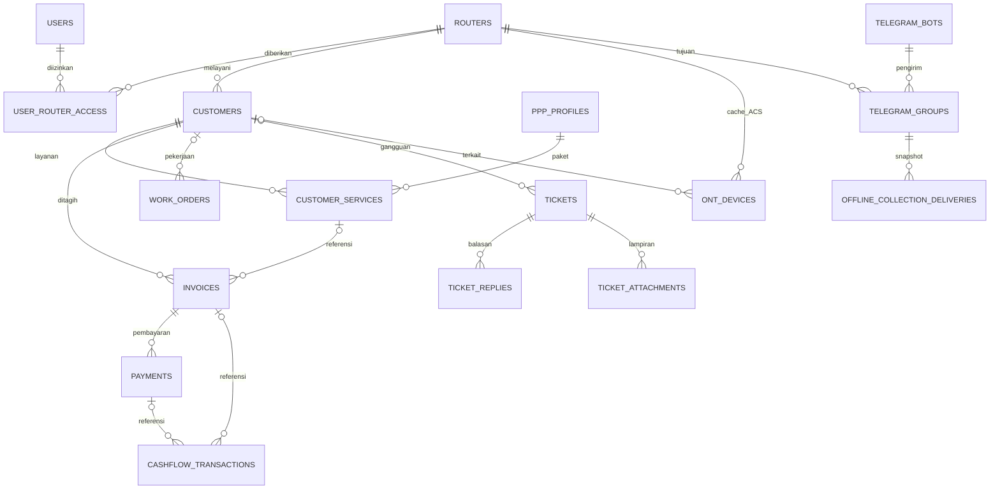

# Spesifikasi teknis dan data RTRWNet

Baseline 22 Oktober 2026. Bagian dari [dokumentasi lengkap](13_DOKUMENTASI_LENGKAP_BILLING_RTRWNET.md). Semua versi di bawah berasal dari source/lock repository, bukan klaim versi terbaru vendor atau hasil pembacaan runtime produksi.

## 1. Arsitektur



Aplikasi adalah monolit MVC dengan custom libraries dan job handler. View dirender PHP; JavaScript menambahkan interaksi, chart, peta, polling, dan realtime notification. Tidak ada build SPA terpisah untuk aplikasi web utama. Pusher menangani push event; polling/cache monitoring tetap merupakan mekanisme terpisah.

## 2. Stack dan kebutuhan runtime

| Lapisan | Spesifikasi dari repository | Referensi |
| --- | --- | --- |
| Framework | CodeIgniter **3.1.13** | [CodeIgniter core](../system/core/CodeIgniter.php) |
| Backend | PHP, MVC, Query Builder, custom controller/service/model | [application](../application) |
| Target installer | Ubuntu 22.04/PHP 8.1 atau Ubuntu 24.04/PHP 8.3 | [installer](../deployment/ubuntu-installer/install.sh), [config installer](../deployment/ubuntu-installer/config.env.example) |
| Web server | Installer Nginx + PHP-FPM; repository juga memiliki `.htaccess` untuk Apache | [template Nginx](../deployment/ubuntu-installer/nginx/rtrwnet.conf.template), [.htaccess](../.htaccess) |
| Database driver | `mysqli`, persistent connection nonaktif | [database.php](../application/config/database.php) |
| Charset koneksi default | `utf8` / `utf8_general_ci`; sejumlah migrasi tabel memakai `utf8mb4` | [database.php](../application/config/database.php), [migrasi WA](../application/migrations/20260511120000_whatsapp_message_logs.php) |
| PDF | `dompdf/dompdf` **v3.1.4** pada lock | [composer.lock](../composer.lock) |
| Redis client | `predis/predis` **v2.4.1**; kode juga mendukung ekstensi phpredis | [JobDispatcher](../application/libraries/JobDispatcher.php) |
| Realtime server SDK | `pusher/pusher-php-server` **7.2.7** pada lock | [composer.lock](../composer.lock) |
| UI utama | Bootstrap **5.3.3**, Bootstrap Icons **1.11.3**, Choices.js, SweetAlert2 | [layout main](../application/views/layout/main.php) |
| Chart | Chart.js **4.4.1** pada layout terkait | [layout scripts](../application/views/layouts/partials/scripts.php) |
| Peta | Leaflet **1.9.4**, MarkerCluster **1.5.3** | [fiber map view](../application/views/network/fiber_network_map.php) |
| Browser realtime | Pusher JS **7.2** pada layout terkait | [layout main](../application/views/layout/main.php) |
| Android | Capacitor package constraint `^7.6.0`, contacts `^7.1.0`, Node `>=20` | [mobile package](../mobile-app/package.json) |
| Android SDK | min 23; compile/target 35 pada file Gradle | [variables.gradle](../mobile-app/android/variables.gradle) |

`composer.json` masih membawa minimum PHP framework lama `>=5.3.7`; ini tidak merepresentasikan kebutuhan source/dependency saat ini. Tidak ada matriks kompatibilitas seluruh versi PHP yang sudah dibuktikan oleh dokumentasi ini. Gunakan target installer lalu jalankan pemeriksaan dependency pada lingkungan tujuan. Package dev PHPUnit yang tercantum juga bukan bukti suite regresi produk lengkap tersedia.

Ekstensi yang dipasang installer meliputi mysqli/mysql, curl, mbstring, XML/DOM, zip, gd, intl, bcmath, opcache, readline, serta redis ketika dipilih. OpenSSL digunakan untuk sebagian enkripsi/integrasi. Jalur FreeACS SOAP membutuhkan dukungan SOAP yang sesuai dan harus diperiksa tersendiri; jangan mengasumsikan seluruh integrasi opsional otomatis siap dari daftar paket umum.

Ukuran CPU/RAM/disk dan batas jumlah pelanggan/router serentak belum memiliki benchmark di peninjauan ini. Angka kapasitas tidak ditetapkan sebagai jaminan produk. Pengukuran perlu memperhitungkan query laporan, polling router, cache, PDF, pertumbuhan log, dan latensi integrasi.

## 3. Struktur source dan tanggung jawab

| Direktori/file | Peran |
| --- | --- |
| `index.php` | Entrypoint, loader `.env`, environment dan timezone |
| `application/core/MY_Controller.php` | Session/login, user aktif, HTTPS, idle timeout, router scope, helper RBAC, log aktivitas |
| `application/controllers/` | Endpoint web dan orchestrasi operasi |
| `application/controllers/cron/` | Billing, monitoring, static sync, offline collection |
| `application/controllers/api/Ont.php` | Endpoint ONT machine-to-machine |
| `application/models/` | Query dan adaptasi schema/field |
| `application/libraries/` | Aturan bisnis, client integrasi, queue, payment/isolation services |
| `application/helpers/` | RBAC, router scope, branding, template pesan, notification, kompatibilitas tenant |
| `application/jobs/` | Handler billing, isolir, MikroTik secret, monitoring, Telegram |
| `application/migrations/` | Perubahan schema berbasis timestamp |
| `application/views/` | Template server-rendered; beberapa keluarga layout/halaman legacy masih ada |
| `assets/`, `public/`, `pwa/` | Asset UI/branding/PWA |
| `application/cache/`, `application/logs/` | Data runtime; bukan seed deployment |
| `deployment/ubuntu-installer/` | Installer, template Nginx/systemd/cron, aturan packaging |
| `mobile-app/` | Wrapper Android, bukan backend/API terpisah |
| `scripts/docs/generate_inventory.py` | Generator lampiran dokumentasi dari source saja |

Library alias dengan perbedaan kapitalisasi seperti `MikrotikManager`/`Mikrotikmanager` dan `JobDispatcher`/`Jobdispatcher` ada untuk kompatibilitas loader. Pada filesystem Linux, nama file/class perlu ditelusuri ke implementasi utama sebelum mengubah atau menghapus wrapper tersebut.

## 4. Model relasi data

Diagram berikut adalah **relasi konseptual yang digunakan aplikasi**, bukan pernyataan bahwa semua foreign key/cardinality dipaksakan schema produksi. Source memakai banyak pemeriksaan `table_exists`, `field_exists`, dan fallback nama field. Satu customer dapat memiliki riwayat/beberapa row service; generator memilih konteks service yang relevan.



### 4.1 Kelompok tabel

| Kelompok | Tabel/referensi pada source | Catatan |
| --- | --- | --- |
| Akses | `users`, `user_router_access`, `user_activity_logs` | Role, router, status aktif, audit |
| Pelanggan/layanan | `customers`, `customer_services`, `pppoe_secrets`, `ppp_profiles`, `ip_pools`, `customer_service_history` | Layanan/harga dan sinkronisasi jaringan |
| Billing | `invoices`, `payments`; `invoice_items` pada sebagian jalur | Invoice reguler utama tidak mensyaratkan item detail dalam validator minimumnya |
| Keuangan | `cashflow_transactions`, `cashflow_categories`, tabel request perubahan yang dikenali controller | Nama schema approval dapat bervariasi |
| Operasional | `work_orders`, `tickets`, `ticket_replies`, `ticket_attachments` | `ticket_comments` pada catatan lama tidak menggantikan konstanta reply di model utama |
| Referensi/topologi | `master_locations`, `master_olts`, fallback `master_olt`, `fiber_odc`, `fiber_odp` | Titik jaringan dan koordinat pelanggan/router |
| Integrasi | `routers`, `telegram_bots`, `telegram_groups`, `ont_devices` | Kredensial/config dan cache perangkat |
| Antrean/notifikasi | `background_jobs`, `notifications`, `wa_message_logs`, `offline_collection_deliveries` | Antrean job dan antrean WA memiliki mekanisme berbeda |
| Observabilitas | `cron_run_logs`, `monitoring_alert_logs`, `monitoring_alert_state`, `monitoring_network_checks`, `system_logs`, `sync_logs` | Pemakaian tergantung schema/modul |
| Settings kompatibilitas | `settings_mikrotik`, `settings_database`, `settings_telegram`, `settings_pppoe_sync` | Tidak semuanya merupakan sumber konfigurasi runtime utama |
| Legacy/opsional | `tenants`, `tenant_subscriptions`, `tenant_invoices`, `tenant_payments`, `packages`, `service_plans`, `technicians`, referensi inventory | Keberadaan referensi bukan bukti fitur SaaS/inventory penuh aktif |

Ini merupakan kamus penggunaan source, bukan daftar tabel hasil `SHOW TABLES`. Tidak ada dump produksi yang disertakan pada baseline dokumentasi ini.

### 4.2 Kamus field pelanggan dan layanan

Field di bawah dikelompokkan berdasarkan makna. Sebagian bersifat opsional atau alias legacy; tipe/length/nullability selain yang disebut eksplisit harus dicocokkan dengan DDL instalasi.

| Entitas/field | Makna dan aturan |
| --- | --- |
| `customers.id`, `customer_code` | Identitas internal dan kode pelanggan |
| `full_name`, `phone`, `address` | Kontak dan alamat; beberapa query mengenali alias nama/nomor legacy |
| `router_id` | Distribusi pelanggan; harus konsisten dengan layanan/invoice/aksi router |
| `status` | Alur billable mengenali active/suspended/isolated/isolir; pending/terminated tergantung schema dan operasional |
| `pppoe_username`, field password PPP | Kredensial layanan; jangan disalin ke bahan presentasi publik |
| `ppp_profile_id`, field harga | Pilihan paket; controller menyesuaikan kolom profile/harga yang tersedia |
| `connection_type` dan alias service mode | Pembedaan PPPoE/static sesuai resolver controller |
| `ip_address`, `remote_ip`, `mac_address` | Alamat jaringan; sinkronisasi static menambah/memanfaatkan kolom terkait |
| `join_date`, `install_date`, `installation_date` | Tanggal bergabung/pemasangan dan fallback legacy |
| `due_date_day` | Hari 1–31; migrasi menambah nullable TINYINT unsigned dan indeks |
| `billing_interval_months` | TINYINT unsigned, default `1`; input divalidasi `1`/`2` |
| `billing_cycle_start` | DATE nullable; untuk interval 2 harus valid pada hari pertama bulan |
| `payment_collection_method` | VARCHAR(20), default `unspecified`; form menerima unspecified/transfer/cash_visit |
| Field koordinat/lokasi/OLT/ODP | Data pemetaan/referensi; nama kolom aktual mengikuti schema |
| `deleted_at`/`is_deleted` bila tersedia | Penanda penghapusan; beberapa model juga menyesuaikan status |
| `customer_services.customer_id` | Pemilik layanan |
| `customer_services.router_id` | Router layanan; digunakan sebagai sumber penting scope billing |
| Profile/plan, username, IP, price pada service | Konteks layanan dan harga yang dipakai resolver billing/upgrade |

Sumber: [Customers](../application/controllers/Customers.php), [Customer_model](../application/models/Customer_model.php), [Billing_automation_model](../application/models/Billing_automation_model.php), [migrasi due day](../application/migrations/20260607120000_customer_due_date_day.php), [migrasi siklus](../application/migrations/20261022120000_customer_billing_cycles_offline_collection.php).

### 4.3 Kamus invoice, payment, dan cashflow

| Field utama | Makna |
| --- | --- |
| `invoices.id`, `invoice_number` | ID internal dan nomor invoice |
| `customer_id`, `customer_service_id` | Relasi pelanggan dan layanan; service dapat null pada jalur tertentu |
| `router_id` | Scope dan branding invoice pada schema router-aware |
| `billing_period_start`, `billing_period_end` | Rentang kalender tercakup; siklus 2 bulan memakai satu invoice untuk dua bulan |
| `issue_date`, `due_date` | Tanggal terbit dan jatuh tempo; generator periodik memakai tanggal awal periode sebagai issue date |
| `subtotal`, `tax_amount`, `discount_amount`, `total_amount` | Komponen tagihan; tax/discount generator reguler bernilai nol |
| `paid_amount`, `balance_amount` | Nominal dibayar dan saldo sisa |
| `status` | issued/partially_paid/overdue/paid/void pada alur utama |
| `paid_date` bila tersedia | Timestamp pelunasan yang diperbarui model |
| `notes`, `created_at`, `updated_at` | Catatan asal/koreksi dan audit waktu |
| `payments.invoice_id`, `customer_id`, `router_id` | Kaitan pembayaran dan scope |
| `payments.amount`, `payment_date`, `method` | Nominal, waktu, metode; tombol lunas cash/bank_transfer |
| `payments.status`, `received_by` bila tersedia | Konfirmasi dan penerima pembayaran |
| `cashflow_transactions.type`, `amount` | income/expense dan nominal |
| `invoice_id`, `payment_id`, `customer_id`, `router_id` pada cashflow | Relasi/fallback identifikasi untuk pencatatan dan pencegahan income ganda |
| Kategori, tanggal transaksi, deskripsi, referensi | Detail laporan; controller memilih field schema yang tersedia |

Validator schema service billing mensyaratkan set berikut:

```text
customers: id, status
invoices: id, invoice_number, customer_id,
          billing_period_start, billing_period_end, issue_date, due_date,
          subtotal, tax_amount, discount_amount, total_amount,
          paid_amount, balance_amount, status, created_at, updated_at
payments: id, invoice_id, amount, payment_date
```

Lulus validator minimal ini belum membuktikan semua modul, router scope, cashflow, atau integrasi sudah lengkap. Engine legacy memakai kontrak berbeda (`period_month`, `amount`, status unpaid); jangan mencampurkan keduanya sebagai satu schema standar.

### 4.4 Field antrean, ONT, dan laporan

| Tabel | Field/karakter utama |
| --- | --- |
| `background_jobs` | job_type, queue_name, payload_json, status, attempts/max_attempts, available_at, started_at, finished_at, last_error, timestamps; tenant_id kompatibilitas |
| `wa_message_logs` | customer_id, invoice_id, phone/normalized_phone, message, status pending/processing/sent/failed, provider_response, error_message, retry_count, sent_at, timestamps |
| `offline_collection_deliveries` | id BIGINT unsigned; period CHAR(7); router_id/telegram_group_id BIGINT unsigned; chat_id VARCHAR(100); part_no INT unsigned; message TEXT; sent_at nullable DATETIME; created_at DATETIME |
| `ont_devices` | serial_number, customer_id, router_id pada schema router-aware, identitas vendor/model, wan_ip, SSID/password, status, last_inform, telemetry tambahan sesuai migrasi |
| `notifications` | user_id/router_id/brand_id, type/category, title/message, reference_id/reference_type, is_read, created_at |
| `user_activity_logs` | user/role, HTTP method, controller/action, request URI/query, ringkasan payload, IP/user-agent, created_at |

Indeks yang dapat ditelusuri pada migrasi/SQL:

- `user_router_access`: UNIQUE `(user_id, router_id)` dan FK user/router dengan cascade.
- `offline_collection_deliveries`: UNIQUE `(period, router_id, telegram_group_id, part_no)`; tidak ada FK eksplisit pada migrasi ini.
- `wa_message_logs`: indeks customer_id, invoice_id, status, created_at.
- `notifications`: indeks user/router/read/time dan gabungan user/read/time.
- SQL repair PPP mendefinisikan keunikan username per router; lihat [repair multi-router](06_DB_REPAIR_MULTI_ROUTER_PPP_SYNC.sql).

Indeks tersebut merupakan definisi di source. Validasi pemasangan/constraint aktual dengan schema-only export atau `SHOW CREATE TABLE` pada lingkungan yang akan diaudit. Jangan menerapkan seluruh SQL historis berurutan tanpa menilai prasyarat dan migrasi yang sudah terpasang.

## 5. Integrasi dan kontrak teknis

### 5.1 MikroTik

Implementasi utama berada di [MikrotikManager](../application/libraries/MikrotikManager.php), [Mikrotik_api](../application/libraries/Mikrotik_api.php), [Pppoe_manager](../application/libraries/Pppoe_manager.php), dan service terkait. Record router menyimpan host, port, user/password, SSL/timeout dan metadata sesuai schema; environment global menjadi fallback pada jalur tertentu.

Operasi yang digunakan mencakup PPP secret/active/profile, IP pool, queue, address list isolir, ARP, interface, resource, log, dan ping. Port fallback konfigurasi adalah 8728. Kemampuan SSL tidak membuktikan seluruh router sudah menggunakannya. Hak API serta konektivitas dari server aplikasi harus sesuai operasi modul yang diaktifkan.

### 5.2 Telegram

[Settings_model](../application/models/Settings_model.php) mengelola bot/grup, termasuk pembacaan secret terenkripsi. Tujuan dapat dipilih berdasarkan router dan tipe grup: teknisi/admin/owner/alert serta `collection`. Aturan fallback berbeda antarmodul; offline collection secara khusus melarang fallback lintas tipe/router.

Webhook `POST /telegram/webhook` memeriksa header `X-Telegram-Bot-Api-Secret-Token` terhadap `TELEGRAM_WEBHOOK_SECRET`. Callback provisioning menggunakan secret tambahan dan validasi sesuai [Telegram_webhook](../application/controllers/Telegram_webhook.php). Endpoint provisioning `/provisioning/store` memakai session dan role admin/superadmin; jangan memperlakukannya sebagai API publik tanpa login.

### 5.3 GenieACS dan FreeACS

URL/NBI dan kredensial ACS dikelola per router melalui [Routeracs](../application/controllers/Routeracs.php) dan [Router_model](../application/models/Router_model.php). [Genieacs](../application/libraries/Genieacs.php) mengelola baca perangkat dan task. Virtual parameters dan preset vendor tersedia di `docs/genieacs_virtual_parameters/` serta `scripts/genieacs/`.

FreeACS menggunakan mode SOAP atau REST bridge dari [tr069.php](../application/config/tr069.php) dan [Tr069_acs_model](../application/models/Tr069_acs_model.php). Nama parameter TR-069/vendor, interval inform, dan respons task memengaruhi hasil; status tugas diterima ACS tidak selalu berarti perangkat telah menerapkan perubahan saat itu juga.

Kontrak machine-to-machine ONT:

| Endpoint | Method | Input utama | Auth |
| --- | --- | --- | --- |
| `/api/ont/set-wifi` | POST | JSON/form customer_id, ssid, password; password minimal 8 karakter | X-API-Key atau Authorization Bearer; basic bila diaktifkan |
| `/api/ont/reboot` | POST | JSON/form customer_id | Sama |
| `/api/ont/connected-devices` | GET | Query customer_id | Sama |

Contoh body set WiFi, hanya ilustrasi kontrak:

```json
{"customer_id": 123, "ssid": "Pelanggan-123", "password": "contoh-password-wifi"}
```

Respons menggunakan JSON `success` dan `message`/data sesuai operasi. Method salah 405, input invalid 422, auth invalid 401, konfigurasi auth kosong 503, beberapa kegagalan operasi 400. Token API tersebut adalah kredensial server, bukan scope session user. Audit pembatasan customer/router untuk pemakaian integrasi sebelum memberikan token kepada pihak lain.

### 5.4 WhatsApp gateway

[Whatsapp_service](../application/libraries/Whatsapp_service.php) membentuk log pending dan memproses queue tersendiri; tidak memakai lima job handler umum sebagai satu-satunya mekanisme. Payload default ke provider: `sender`, `number`, `message`. Header default `Authorization: Bearer <token>` dapat dikonfigurasi. Mapping vendor berada di [whatsapp.php](../application/config/whatsapp.php).

Nomor dinormalisasi oleh service; sukses enqueue berbeda dari sukses kirim provider, dan sukses provider belum membuktikan penerimaan pelanggan. Status dan respons provider disimpan untuk review/resend. Detail konfigurasi/jadwal di [panduan WA](WHATSAPP_GATEWAY_USAGE.md).

### 5.5 Queue dan Pusher

JobDispatcher menyimpan record di `background_jobs` terlebih dahulu. Jika driver Redis aktif dan koneksi berhasil, ID job didorong ke Redis; bila tidak, record tetap tersedia melalui database queue. Worker CLI melakukan reserve, menjalankan handler, menyimpan success/failed, dan retry/backoff sesuai konfigurasi. Lima handler yang tersedia: BillingGenerateJob, IsolirJob, MikrotikCreateSecretJob, MonitoringJob, TelegramSendJob.

Worker mode `once` memproses paling banyak satu job per pemanggilan; argumen tambahan seperti `once 10` tidak berarti sepuluh job karena loop langsung berhenti setelah job pertama pada mode once. Worker perlu diawasi process manager; perubahan source worker memerlukan restart proses untuk memuat kode baru.

Pusher mengirim event notification melalui channel yang dikonfigurasi, termasuk private channel per user dan endpoint `/notification/auth`. Penyimpanan notifikasi tetap ditangani model/database. Konfigurasi channel publik harus dipahami ketika menentukan informasi yang dibroadcast.

## 6. Konfigurasi environment

Entrypoint memuat `.env` root tanpa mengganti nilai environment yang sudah ada. Untuk deployment, jadikan [.env.example](../.env.example) sebagai kontrak dasar; jangan menyalin `.env` live ke source/package. Nama database bukan konstanta produk: runtime memerlukannya dari konfigurasi env.

| Grup | Variabel penting | Perilaku/default yang perlu diketahui |
| --- | --- | --- |
| Core | CI_ENV, DB_HOST, DB_PORT, DB_NAME, DB_USER, DB_PASS, CI_ENCRYPTION_KEY | Config DB menolak fallback hardcoded; default port 3306 |
| Branding | APP_BRAND_NAME/TAGLINE/COMPANY, COMPANY_NAME/TAGLINE/ADDRESS/PHONE/EMAIL/WEBSITE | Branding global; invoice dapat mengambil branding router |
| Web/security | APP_FORCE_HTTPS, APP_TRUSTED_PROXIES, APP_LOG_THRESHOLD | Contoh force HTTPS 0; set sesuai terminasi HTTPS/proxy |
| Login/session | AUTH_LOGIN_MAX_ATTEMPTS, AUTH_LOGIN_WINDOW_SECONDS, AUTH_LOGIN_LOCK_SECONDS, AUTH_SESSION_IDLE_TIMEOUT | Default 8 percobaan, window/lock 900 detik, idle 600 detik |
| Cron/callback | CRON_TOKEN, MONITORING_CRON_TOKEN, CRON_NOTIFICATION_KEY, PROVISIONING_CALLBACK_SECRET, TELEGRAM_WEBHOOK_SECRET | Guard berbeda per controller; CLI tidak selalu memerlukan token |
| MikroTik | MIKROTIK_HOST/PORT/USER/PASS/SSL/TIMEOUT/RETRY_MAX/RETRY_DELAY/ISOLIR_LIST | Fallback global; isolir list default ISOLIR |
| Pelunasan | BILLING_APPLY_MIKROTIK_ON_MARK_PAID | Contoh/default pemakaian 0; tidak menonaktifkan cabang release isolir setelah commit |
| Queue | QUEUE_DRIVER, QUEUE_ENABLE_ASYNC, QUEUE_NAME | `.env.example`: database, 1, default; `queue.php` tanpa env: redis |
| Worker | QUEUE_POLL_SLEEP_SECONDS, QUEUE_POP_TIMEOUT_SECONDS, QUEUE_DEFAULT_MAX_ATTEMPTS, QUEUE_BACKOFF_BASE_SECONDS, QUEUE_BACKOFF_MAX_SECONDS | Default config 1, 2, 5, 5, 300; pembacaan/efek setiap opsi perlu dilihat pada worker |
| Redis | REDIS_HOST/PORT/DB/TIMEOUT/PASSWORD/PREFIX | Contoh 127.0.0.1:6379, DB0, prefix rtrwnet: |
| Pusher | PUSHER_APP_ID/KEY/SECRET/CLUSTER/USE_TLS, channel/prefix/event vars | Cluster contoh ap1; realtime memerlukan konfigurasi lengkap |
| Telegram | TELEGRAM_BOT_TOKEN | Token global opsional; bot/grup per-router dikelola database |
| ONT API | TR069_API_TOKEN, TR069_API_BASIC_ENABLED/USER/PASS | Auth kosong ditolak; basic default nonaktif |
| FreeACS | FREEACS_MODE, SOAP_URL/login, HTTP_USER/PASS, REST_BASE_URL/TOKEN, TIMEOUT, VERIFY_SSL | Endpoint harus eksplisit; verify SSL default pada contoh 0 |
| GenieACS | GENIEACS_TIMEOUT, VERIFY_SSL, TASK_CONNECTION_REQUEST, VPARAM_* | Timeout default 20; endpoint per router di DB; verify SSL contoh 0 |
| WhatsApp | WA_ENABLED, WA_PROVIDER, WA_API_URL/TOKEN, WA_SENDER, WA_PAYMENT_INFO | Tidak tercakup lengkap `.env.example`; config wa_enabled default true tetapi URL/token tetap harus diisi |
| WA queue | WA_DELAY_SECONDS, WA_QUEUE_LIMIT, WA_MAX_RETRY, WA_TIMEOUT_SECONDS, WA_CONNECT_TIMEOUT_SECONDS, WA_PROCESSING_TIMEOUT_MINUTES, WA_REMINDER_LIMIT, WA_CRON_SECRET | Default config 15s, 10, 3, 20s, 8s, 15m, 100; due reminder offsets 3/1/0 di file config |

Inventaris nama environment dan lokasi referensinya tersedia pada [lampiran source](16_REFERENSI_ENDPOINT_DAN_SOURCE.md). Beberapa config memakai pembanding string ketat `=== '1'`, lainnya parser boolean; ikuti format masing-masing contoh/file, bukan mengganti semua nilai boolean secara seragam.

## 7. Keamanan, session, dan audit yang terimplementasi

| Kontrol | Implementasi dan batas |
| --- | --- |
| Password login | Hash BCRYPT saat kelola user; password_verify saat login |
| Login | Captcha aritmetika, tracking/rate limit, user status active, normalisasi role |
| Session | Driver files; expiration 7200s, regenerasi 300s, SameSite Lax; idle timeout aplikasi default 600s |
| Cookie | HttpOnly; Secure mengikuti HTTPS/force HTTPS; proxy harus dikonfigurasi benar |
| CSRF | Aktif, expiry 7200s dan regenerasi token; ONT API/Telegram webhook dikecualikan karena auth lain |
| Scope | Router aktif dan daftar router user; helper/filter/model mengimplementasikan pembatasan |
| Secret integrasi | Settings_model mengenali format enkripsi `ci3:`/`osl:` dan kompatibilitas plaintext lama; bukan jaminan semua field sensitif terenkripsi |
| Aktivitas user | Log ringkas untuk aksi mutasi dan logout; GET AJAX/polling tertentu tidak dicatat |
| Payload log | Base controller menyimpan ringkasan ID/jumlah field; log error/debug pada modul lain perlu ditinjau tersendiri |
| Lampiran tiket | Ekstensi jpg/jpeg/png/pdf/doc/docx/txt, batas 8192 KB, nama acak pada controller |
| Logo router | jpg/jpeg/png/webp, batas 2048 KB, nama acak |
| Migrasi/worker | Controller Migrate dan Worker menolak HTTP |

`Auth_hook.php` ada tetapi file hook config tidak mendaftarkannya sebagai guard global; kontrol utama yang ditinjau berada pada controller/base controller. Tidak semua controller mewarisi MY_Controller (auth, webhook, cron dan API memakai guard sendiri). Tidak ada klaim audit penetrasi lengkap, isolasi sempurna semua endpoint, enkripsi menyeluruh database, atau kepatuhan standar tertentu dari pemeriksaan dokumentasi ini.

## 8. Karakter nonfungsional dan batas yang terukur

| Topik | Bukti source / kebutuhan verifikasi |
| --- | --- |
| Pagination | Halaman daftar memakai helper pagination; default sejumlah controller 20 row |
| Monitoring | Refresh 10s dan snapshot cache 45s pada config; konfigurasi per router ikut berpengaruh |
| Keandalan job | Record DB, retry/backoff dan delayed queue; bukan jaminan exactly-once semua efek eksternal |
| Keandalan collection | DB advisory lock dan status part; ada celah duplikasi jika kirim berhasil lalu simpan status gagal |
| Persistensi finansial | Transaksi DB pada alur payment; panggilan router/HTTP tidak ikut transaksi atomik |
| Offline | Service worker dapat menyimpan halaman navigasi dan asset; tidak ada antrean pembayaran offline lengkap yang diverifikasi |
| Availability | Worker/systemd dan cron disediakan; cluster/failover/replikasi belum diverifikasi |
| Encoding | Koneksi utf8 dan sejumlah tabel utf8mb4 perlu diuji untuk karakter di luar BMP seperti emoji |
| Portabilitas schema | Banyak fallback field/tabel; memerlukan schema compatibility test, bukan asumsi semua DB lama cocok |
| Kinerja | Tidak ada angka concurrency, ukuran pelanggan, waktu query atau RTO/RPO yang telah diukur di audit ini |

Spesifikasi kapasitas dan SLA operasional baru dapat dibakukan setelah uji beban, pengukuran pertumbuhan data, dan simulasi restore pada lingkungan yang representatif.
